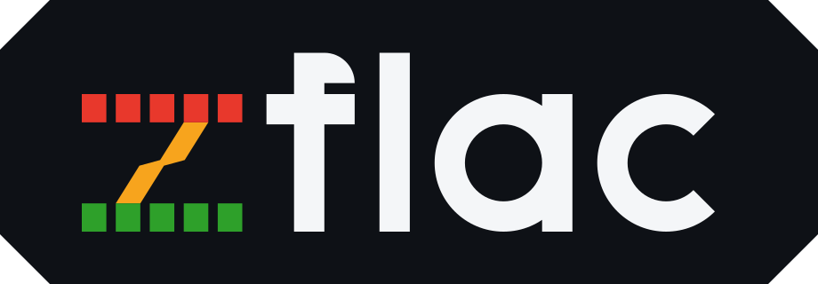

<p align="center">
  <a href="https://github.com/ludiazv/zflac"></a>
</p>

A small, high-performance Zig binding for the [libFLAC](https://github.com/xiph/flac)
stream encoder and decoder. Designed specifically for environments where memory
predictability is critical—such as embedded systems.

Zig 0.17 · libFLAC 1.5.0 (vendored, trimmed to 15 C files) · MIT License

## Quick Start

Add the package to your project using `zig fetch`:

```sh
zig fetch --save git+https://github.com/ludiazv/zflac
```

Then, import and use it in your code:

```zig
const std = @import("std");
const flac = @import("zflac");

pub fn main() !void {
    var arena = std.heap.ArenaAllocator.init(std.heap.page_allocator);
    defer arena.deinit();

    // Route libFLAC's own buffers through this allocator instead of malloc().
    flac.setAllocator(arena.allocator());

    // 512 stereo frames of 16-bit PCM, interleaved: l r l r ...
    var pcm: [1024]i32 = @splat(0);
    var encoded: [4096]u8 = undefined;

    var sink = flac.MemorySink{ .buffer = &encoded };
    var encoder = flac.Encoder{};
    try encoder.init(sink.sink(), .{
        .channels = 2,
        .bits_per_sample = 16,
        .sample_rate = 44100,
        .block_size = 256, // keeps libFLAC's own heap under ~76 KiB
    });
    defer encoder.deinit();

    try encoder.encode(&pcm);
    try encoder.finish();

    var source = flac.MemorySource{ .data = sink.bytes() };
    var collected: [1024]i32 = undefined;
    var collector = flac.PcmCollector(i32){ .samples = &collected };

    var decoder = flac.Decoder{};
    try decoder.init(source.source(), collector.output(), .{});
    defer decoder.deinit();

    try decoder.decode();
    std.debug.print("{d} frames, {d} samples, {d} bytes\n", .{
        collector.frames,
        collector.length,
        sink.bytes().len,
    });
}
```

This is `examples/quickstart.zig`, so you can run it with `zig build
quickstart`. It prints `2 frames, 1024 samples, 114 bytes`.

## What it covers

- **Decoder**: Converts FLAC streams into interleaved or planar PCM, with seeking, MD5
  verification and metadata callbacks.
- **Encoder**: Converts PCM into FLAC streams, with the usual tuning knobs.
- **Interfaces**: High-level `Source`, `Sink`, and `Output` abstractions. The library never opens
  a file, never allocates a buffer for you, and never assumes an OS is there.
- **Memory Helpers**: Ready-made pieces for working
  out of fixed buffers.

**Note:** This library is a subset. It does *not* support Ogg containers, the metadata object API, cue sheets,
pictures, replay gain, or the SIMD kernels. For those, use the system libFLAC (`-Dflac-system`).

## How it works (The "Embedded" way)

To keep the memory footprint predictable, the library does not use hidden heap allocations.

### Allocator Control
LibFLAC calls `malloc`, `realloc`, `calloc`, and `free` directly, so this package compiles the C sources
with those names rewritten to `zflac_malloc` and friends, which are implemented on top of a Zig
allocator:

```zig
flac.setAllocator(my_allocator);
```

By default (if `setAllocator` isn't called), it falls back to the system's C `malloc`, which is
what stock libFLAC does. On a target with no C library there is nothing
sensible to fall back to, so libFLAC's first allocation fails with
`error.OutOfMemory` until you install one. `flac.getAllocator()` reports what
is currently in use.

Swapping the allocator later is only safe once every encoder and decoder is
deinitialized: libFLAC gives a block no way back to the instance that allocated
it, so a block from the old allocator handed to the new one is undefined
behaviour. In Debug and ReleaseSafe `setAllocator` panics if libFLAC still holds
a block instead of letting you do it. `flac.liveBlocks()` is the same counter —
a cheap leak check, and always 0 in ReleaseFast where the counter is compiled
out.

### Memory Footprint
Measured via `zig build memstats`, which wraps the C allocator in a meter.
These numbers are libFLAC's internal buffers only — the `Encoder`/`Decoder`
structs, your `Source`/`Sink` buffers and the PCM you hand over are yours to
size.

Decoder (stereo 16-bit, MD5 checking on):

| block size | after `init` | peak while decoding |
| ---------- | ------------ | ------------------- |
| 256        | 17 KiB      | 23 KiB              |
| 1024       | 17 KiB      | 39 KiB              |
| 4096       | 17 KiB      | 100 KiB             |

Encoder:

| config                        | after `init` | peak |
| ----------------------------- | ------------ | ---- |
| 1ch 16-bit 8 kHz block 256    | 71 KiB     | 71 KiB |
| 1ch 16-bit 44.1 kHz block 256 | 71 KiB     | 71 KiB |
| 2ch 16-bit 44.1 kHz block 256 | 75 KiB     | 76 KiB |
| 2ch 16-bit 44.1 kHz block 1024| 136 KiB    | 140 KiB |
| 2ch 16-bit 44.1 kHz block 4096| 382 KiB    | 406 KiB |
| 2ch 24-bit 48 kHz block 4096, level 8 | 384 KiB | 417 KiB |

*Note: Encoding costs several times more than decoding and scales with block
size: `block_size = 256` keeps a stereo encoder under ~76 KiB, the default
4096 pushes it past 400 KiB. Set `block_size` explicitly when the heap budget
matters.

## Important Notes

- **Thread Safety:** The encoder is single-threaded by design; it does not require or use OS threading primitives.
- **Samples must fit in `bits_per_sample`.** For 16-bit input that means
  -32768..32767; libFLAC rejects a wider sample with `error.ClientError`
rather than clamping it.
- **Initialization:** The `Decoder` and `Encoder` structs are initialized in-place. **Do not move or copy them** after
initialization, as libFLAC stores a pointer to the struct for its callbacks, and keep it alive until `deinit`.
Declare them as `var` in place.
- **File I/O:** the vendored C sources need a C standard library (libc);
  cross-compiling for a bare target means supplying a libc (newlib, picolibc,
  musl) or building libFLAC yourself and using `-Dflac-system`. A libc without
  `fseeko()`/`ftello()` needs `-Dflac-fseeko=false`. The generated C bindings
  are part of the same requirement: the public headers include `<stdio.h>`, so
  a target with no libc at all fails in the translate-c step, not in the C
  compile.
- **`zig build test` looks red in Debug, but isn't.** libFLAC's debug build
  prints `Rewinding, seeking not necessary` to stderr during the seeking test,
  and Zig's build runner prints a `failed command: ...` block whenever a
  test binary writes anything to stderr (ziglang/zig#35202). The step exits 0
  and `--summary all` reports every test passing. `zig build
  -Dtest-flac-assertions=false test` is silent and keeps the assertions
  everywhere else.
- **Debug libFLAC talks.** With `-Dflac-assertions` on (the default in Debug)
  libFLAC prints things like `Rewinding, seeking not necessary` to stderr.
  Build with `-Dflac-assertions=false` to silence it.
- **One block is not enough to see output.** The encoder holds a full block
  back; if you feed it exactly `block_size` samples, nothing is written until
  `finish()`.
- **`finish()` on the decoder is the MD5 check.** It returns `false` when the
  decoded audio does not match the signature in STREAMINFO. `deinit` calls it
  for you, so check it explicitly if you care.

## Build options

| option                | default   | description                                            |
| --------------------- | --------- | ------------------------------------------------------ |
| `-Dflac-system`       | `false`   | link a system libFLAC instead of the vendored one      |
| `-Dflac-alloc-hooks`  | `true`\*  | route libFLAC's allocations through `setAllocator` |
| `-Dflac-assertions`   | Debug only| keep libFLAC's `FLAC__ASSERT`s and debug prints    |
| `-Dflac-libc`         | hosted    | link a C standard library (newlib, musl, etc.)        |
| `-Dflac-libm`         | hosted    | link libm (the encoder's entropy coder needs it)      |
| `-Dflac-fseeko`       | `true`    | turn off for a libc without `fseeko()`/`ftello()`     |
| `-Dtest-flac-assertions` | as `-Dflac-assertions` | assertion setting for the test build only; off = quiet test output |

\* unless `-Dflac-system` is on.

Steps: `zig build` (library, plus `zig-out/bin/convert`), `zig build test`,
`zig build example` (encode + decode + write `roundtrip.flac`), `zig build
quickstart` (the snippet above), `zig build memstats` (the table above).

`examples/convert.zig` is a small command-line converter, built by `zig build`
and run as `zig-out/bin/convert`:

```sh
zig-out/bin/convert input.wav output.flac   # PCM -> FLAC
zig-out/bin/convert input.flac output.wav   # FLAC -> PCM
```

It is an example rather than a shipped tool — zflac has no CLI on purpose — but
it is the smallest program that uses all three callback interfaces at once: a
seekable `Source`, an `Output` that writes each frame as it arrives, and a
seekable `Sink` that lets libFLAC go back and fill in STREAMINFO. Neither
direction holds a whole file; audio moves in chunks of 4096 sample frames, and
8/16/24/32-bit and 1–8 channel WAVs round trip byte for byte.

`./scripts/ci.sh` runs the whole matrix — format, every option combination, the
steps above, and the cross-target builds — in one go. It takes a `ZIG`
environment variable if `zig` is not on `PATH`.

## Layout & Dependencies

- `src/flac.zig`: Public API.
- `src/flac/flac.h`: the C headers the bindings cover; the single file the
  translate-c package translates at build time.
- `src/flac/c.zig`: the generated C bindings, re-exported as `c`.
- `src/flac/decoder.zig`: Decoder + C callbacks.
- `src/flac/encoder.zig`: Encoder + C callbacks.
- `src/flac/interfaces.zig`: Source / Sink / Output + in-memory implementations.
- `src/flac/pcm.zig`: interleaved ↔ planar helpers, PcmCollector.
- `src/flac/types.zig`: StreamInfo, Frame, Metadata, status enums.
- `src/flac/errors.zig`: one error set, mapped from libFLAC's statuses.
- `src/flac/alloc.zig`: malloc/calloc/realloc/free → Zig allocator.
- `vendor/flac`: A trimmed copy of libFLAC 1.5.0 — 15 translation units, the headers
  they need, and a hand-written `config.h`. `vendor/re-vendor.sh` re-copies it
  from an upstream checkout; `vendor/flac/README.md` records what was taken and
  why. libFLAC itself is Xiph BSD-style; see `vendor/flac/COPYING.Xiph`.
- **Build-time dependency:** the C bindings are generated by the
  [translate-c](https://codeberg.org/ziglang/translate-c) package (pinned in
  `build.zig.zon`, which also pulls in its `aro` preprocessor dependency).
  They are fetched into the local package directory on a cold build, so the
  first build of a fresh checkout needs network access; `-Dflac-system` uses
  the system libFLAC's headers instead of the vendored ones.
- `examples/roundtrip.zig`: encode, decode, compare, and write `roundtrip.flac`.
- `examples/convert.zig`: the `wav <-> flac` converter described above.
- `examples/quickstart.zig`, `examples/memstats.zig`: the README snippet, and
  the heap table.
- `scripts/ci.sh`: The verification matrix. Single source of truth, so CI and a
  local run ask the same questions.
- `.github/workflows/ci.yml`: Runs `scripts/ci.sh` on Linux, and `zig build
  test` natively on Windows and macOS — the cross builds only approximate those
  two toolchains.

## Logo

`assets/` holds the logo: a "Z" set in FLAC's level-meter bars with a Zig-style
lightning bolt for a diagonal, which doubles as the initial of the wordmark. `zflac-badge.svg` for READMEs and docs,
`zflac-lockup.svg` for light backgrounds, `zflac-mark.svg` for favicons,
`zflac-mark-mono.svg` for small sizes. Palette,
clear space and minimum sizes are in [`assets/README.md`](assets/README.md).

## License

MIT for the bindings, Xiph BSD-style for the vendored C. See `LICENSE`.
